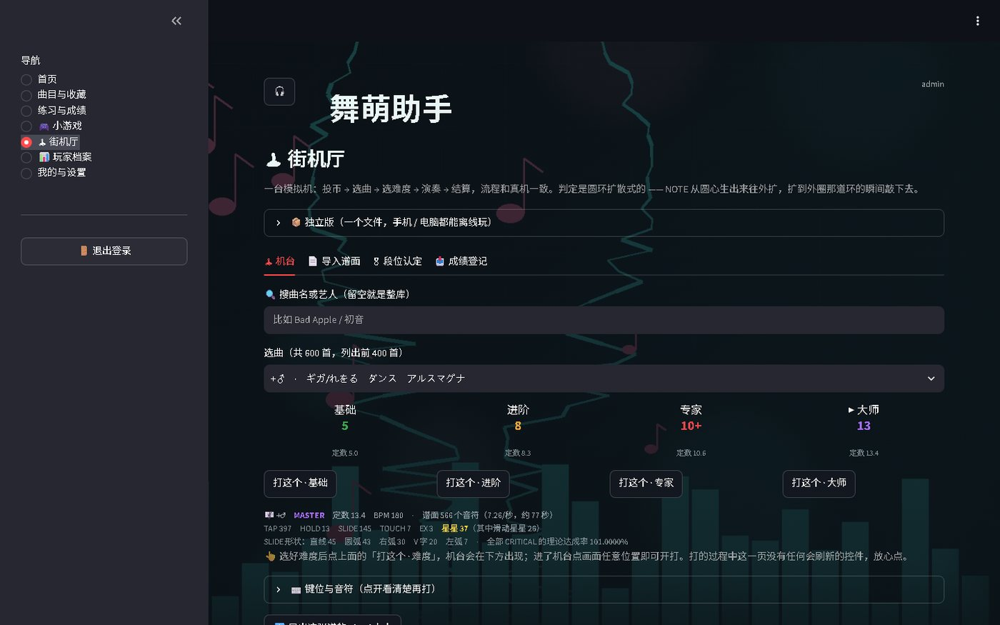
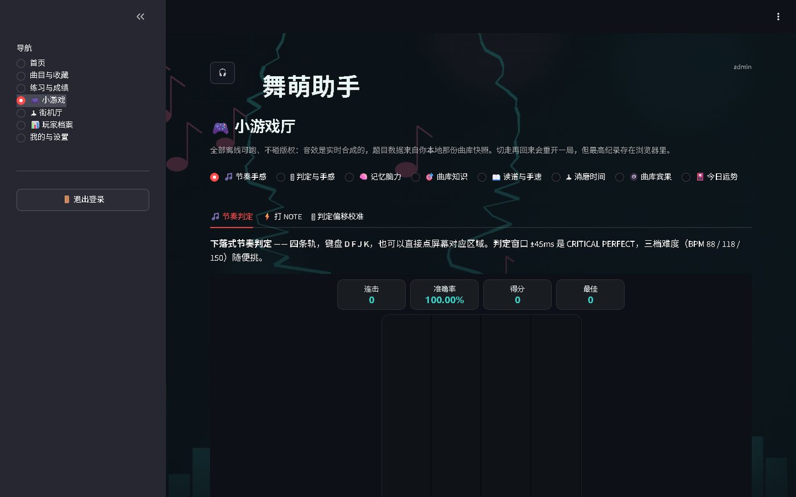
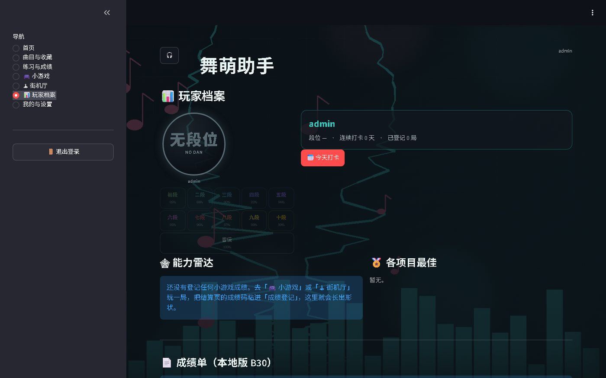

# 舞萌助手 · MAIMAI PLAYER HUB（完整版）

> 一个跑在自己电脑上的舞萌 DX（maimai DX）个人助手。曲库、点歌、练习与成绩、小游戏厅、街机厅、玩家档案、Simai 谱面导入导出，全部本地运行。

[](https://www.python.org/)
[](https://streamlit.io/)
[](LICENSE)
[](#隐私)


## 这是什么

这是完整版：**7 个页面 + 街机厅 + 20 多个小游戏 + Simai 谱面引擎**。
和之前的精简版相比，多了小游戏厅、街机厅（机台/段位认定/成绩登记）、玩家档案（B30/雷达）、Simai 导入导出。

**私人剧情 / VIP 空间没有包含在这个仓库里。** 这是作者自己的私人内容（剧情、信件、角色、验证题），
不属于开源范围；代码里也已经移除了对应模块和入口，跑起来不会出现空白页。

## 截图

| 首页 | 街机厅 |
|---|---|
|  |  |
| **小游戏厅** | **玩家档案** |
|  |  |
| **曲目与收藏** | **我的与设置** |
|  |  |

## 功能

- **首页**：段位、连续打卡、今日运势、今日选曲入口。
- **曲目与收藏**：1400+ 首国服曲库，按难度/定数/BPM/分类筛选；收藏；本地原创 BGM 播放；YouTube 官方嵌入；网易云/QQ 音乐正版搜索入口。
- **练习与成绩**：练习清单、手动成绩（分数/达成率/FC/AP）、每用户隔离。
- **小游戏厅**：20+ 个自包含 HTML/Canvas 小游戏（节奏判定、音符记忆、打 NOTE、2048、翻牌、曲名打字、读谱训练、判定校准、和弦同押、节奏回声、生存模式等）。
- **街机厅**：照真机布局的 DX 机台（8 类音符、圆环判定、合成音效、结算/成绩码）；支持 **Simai 谱面导入导出**；段位认定（实技+笔试）；成绩登记。
- **玩家档案**：本地 B30、能力雷达、打卡、小游戏最好成绩。
- **我的与设置**：主题、等级、改密码、数据备份、曲库刷新、管理员面板（应用名/名言/攻略）。
- **隐私**：账号、收藏、成绩、打卡只存本机 JSON；密码 scrypt 加盐哈希；无埋点、不联网同步。

## 快速开始

需要 Python 3.10+（推荐 3.12）。

```bash
git clone https://github.com/lishuguang0811/maimai-player-hub.git
cd maimai-player-hub

python -m venv .venv
# Windows
.venv\Scripts\activate
# macOS / Linux
source .venv/bin/activate

pip install -r requirements.txt
streamlit run app.py
```

Windows 也可以双击 `start.bat`（首次会自动建虚拟环境并装依赖）。
打开 <http://localhost:8501>，手机同一 WiFi 用 `http://电脑IP:8501`。

### 首次运行

- 管理员账号 `admin`：设置环境变量 `MPH_ADMIN_PASSWORD` 就用它；否则随机生成 16 位密码，写入 `data/INITIAL_ADMIN_PASSWORD.txt`（已 gitignore）。
- 曲库优先读 `data/maimai_songs.json`，缺失时联网从 diving-fish 抓取。
- 账号/成绩/打卡文件按需创建。

> 登录管理员后请立刻在「我的与设置 → 修改密码」里改掉初始密码。

## 项目结构

```
maimai-player-hub/
├── app.py                  # 7 页路由 + 迷你播放器
├── config.py               # 参数/等级/配色/管理员
├── requirements.txt
├── start.bat
├── modules/
│   ├── accounts.py         # 注册/登录/scrypt/找回/管理员
│   ├── songs.py            # 曲库快照/筛选/B 站链接
│   ├── recommend.py        # 三档推荐 + 加权
│   ├── music.py            # 播放状态机 + 音源适配器
│   ├── bgm.py              # 本地 BGM
│   ├── userdata.py         # 收藏/练习/成绩（按用户隔离）
│   ├── guides.py / quotes.py
│   ├── minigames.py        # 运势/定数竞猜/BPM 速猜/比大小
│   ├── arcade.py           # 20+ HTML 小游戏
│   ├── maimai.py           # DX 谱面引擎（确定性生成）
│   ├── dx_cabinet.js       # 机台前端（圆环判定/结算/成绩码）
│   ├── simai.py            # Simai 导入导出
│   ├── dan.py              # 段位认定
│   ├── playlog.py          # 成绩码/打卡/能力统计
│   ├── netease.py          # 网易云校对映射
│   └── ...
├── data/
│   ├── maimai_songs.json   # 曲库快照
│   ├── netease_map.json    # 曲目 → 网易云 song_id（校对过的）
│   ├── bg/ (50)            # 程序生成背景
│   ├── bgm/ (16)           # 原创合成 BGM
│   └── miku/ (8)           # 原创初音插画
├── android/                # Android WebView/原生工程 + 构建脚本（可选）
├── standalone/             # 单文件机台/大厅 HTML
├── tests/                  # 5 套 Python 测试
├── work/                   # 素材生成、构建、node 冒烟
└── docs/screenshots/
```

## 测试

Python 测试使用临时数据目录（`tests/_env.py` 把 `MPH_DATA_DIR` 指到系统临时目录），不会改你的 `data/`。

```bash
python tests/smoke_test.py      # 曲库/账号/设置/推荐
python tests/birthday_test.py   # 生日 1900-2035 边界
python tests/phase3_test.py     # 收藏/练习/成绩/隔离/加权
python tests/music_test.py      # 播放状态机/适配器/YouTube 解析
python tests/ui_test.py         # 登录/注册/七页导航/管理员
```

node 冒烟（可选，需要 Node.js）：

```bash
node work/smoke_dx.js           # 机台谱面整张打一遍
node work/smoke_games.js        # 小游戏逐个跑
node work/smoke_hub.js          # 整合大厅
node work/smoke_standalone.js   # 单文件壳
```

## Android / 桌面打包

`android/` 下保留了 WebView 大厅工程、原生 Java 引擎和构建脚本。
需要自备 JDK 17 + Android SDK build-tools；脚本里的路径请按你的环境改。
`standalone/maimai-hub.html` 是免构建的单文件版本，双击即玩。

## 数据来源与版权

- 曲库元数据来自 [diving-fish maimai DX 查分器](https://www.diving-fish.com/api/maimaidxprober/music_data)，仅标题/艺术家/难度/定数/BPM。
- 在线曲目只给网易云/QQ 音乐搜索链接，不抓取、不托管音频。
- `data/bg/`、`data/bgm/`、`data/miku/` 为程序生成的原创素材，以 MIT 随项目发布。
- 仓库**不包含**任何游戏音频、官方曲绘、官方立绘或街机素材。

本项目是非官方粉丝作品，与 SEGA、Wahlap（华立科技）、Crypton Future Media 均无关联。
「舞萌 DX」「maimai」及相关商标归其各自权利人所有。

## 隐私

- 所有账号、收藏、成绩、打卡都在本机 `data/`，不上传。
- 密码 `hashlib.scrypt` 加盐哈希；无埋点、无遥测。
- 想清空：停止应用后删掉 `data/accounts.json`、`data/userdata.json`、`data/playlog.json`、`data/dan.json`。

## License

代码与仓库内自制图片/音频以 [MIT](LICENSE) 发布。第三方内容（名言、攻略引用、曲目元数据）版权归原作者，仅作学习与个人使用。

## 致谢

- [diving-fish / maimaidx-prober](https://github.com/Diving-Fish/maimaidx-prober) 提供曲库接口
- [Streamlit](https://streamlit.io/) 让单文件应用成为可能
- 所有在机厅里认真读谱的人
