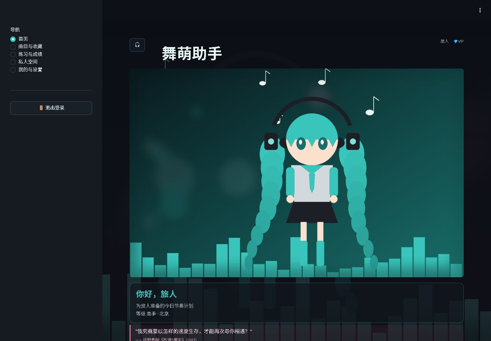
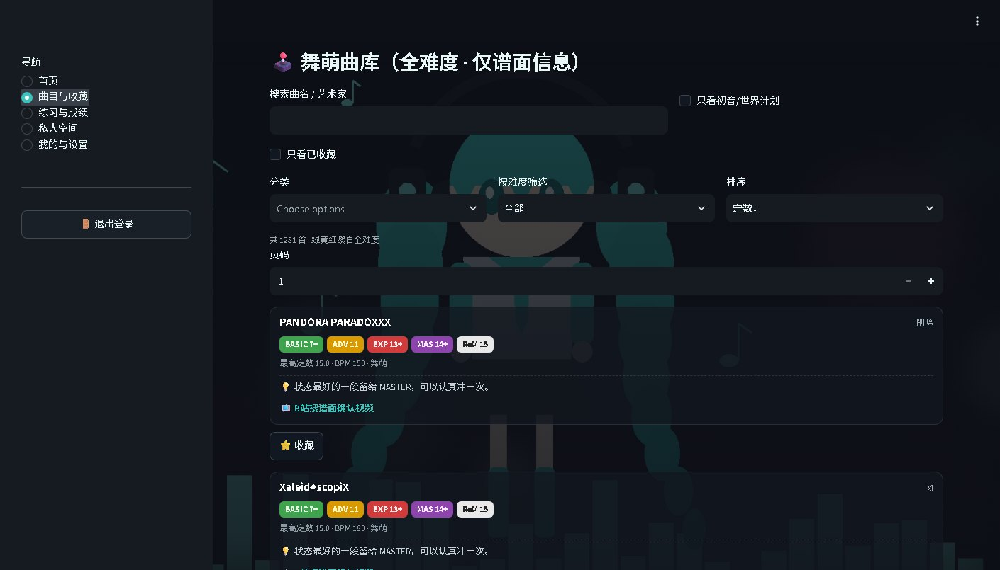
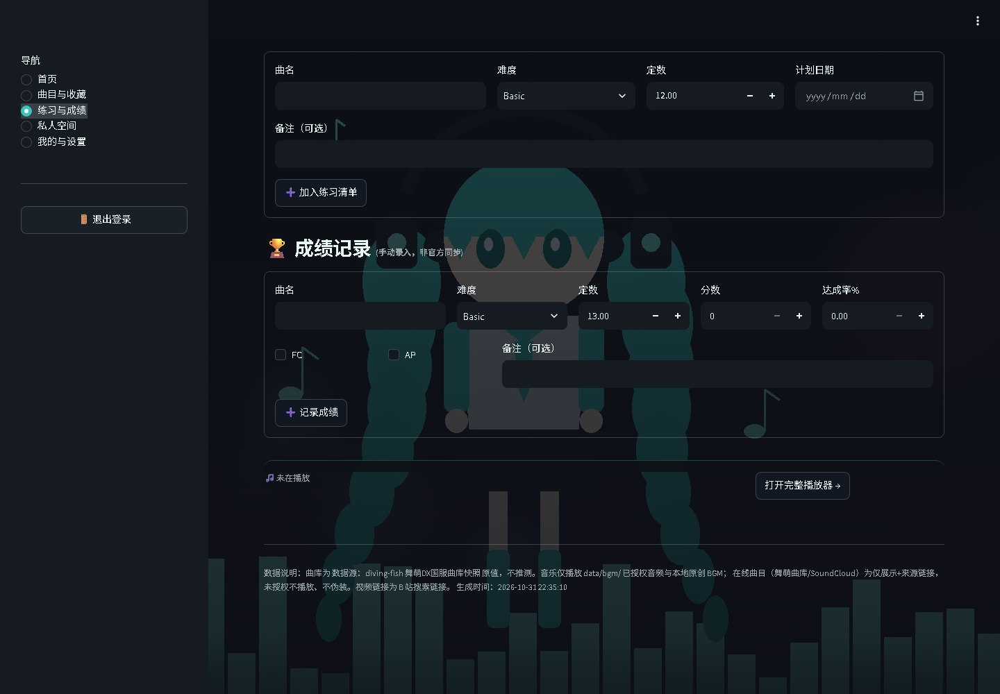
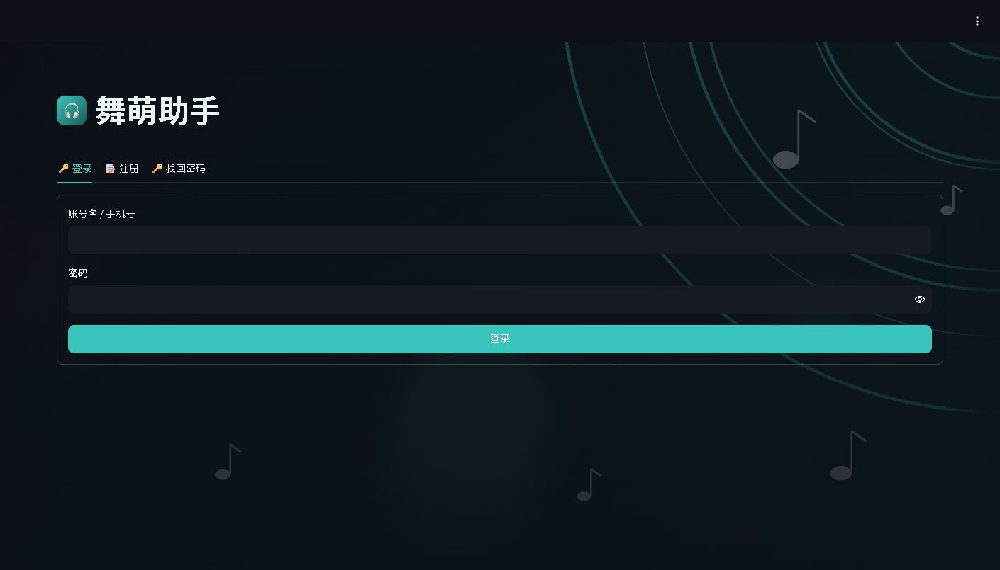
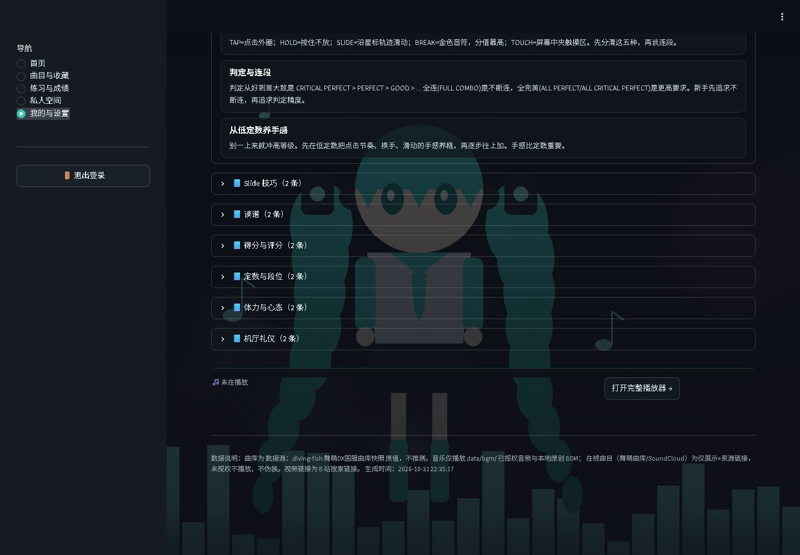
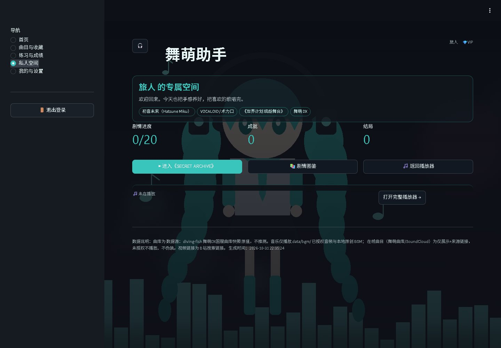

# 舞萌助手 · MAIMAI PLAYER HUB

> 一个跑在自己电脑上的舞萌 DX（maimai DX）个人助手：曲库检索、选曲推荐、练习清单、成绩记录、收藏、分享图，以及一个可以自己写的「私人空间」。

[](https://www.python.org/)
[](https://streamlit.io/)
[](LICENSE)
[](#隐私)



## 这是什么

一个**完全本地运行**的 Streamlit 应用。数据存在本机 JSON 里，不上传、不联网同步、不收集任何统计。

它不是查分器，也不替代官方工具：

- 曲库来自 [diving-fish](https://www.diving-fish.com/maimaidxprober/) 的公开接口，只做检索与展示。
- 成绩是**手动录入**的，界面会明确标注，不假装已经和机台同步。
- 在线曲目只提供官方嵌入或来源链接，不抓取、不托管任何未授权音频。

## 功能

- **曲库与选曲**：1200+ 首国服曲目，按难度/定数/BPM/分类筛选，支持搜索、收藏、B 站谱面确认入口。
- **每日推荐**：按账号等级分三档窗口，结合爱好、收藏、历史成绩加权；同一天结果稳定。
- **练习清单**：加任务、改状态、记录完成日期，和真实成绩分开。
- **成绩记录**：分数、达成率、FC/AP、备注，带范围校验；个人统计。
- **音乐播放器**：16 首程序合成的原创 BGM 可直接播放；YouTube 走官方 `youtube-nocookie` 嵌入；未配置 SoundCloud 密钥时明确提示不可用。
- **分享图**：Pillow 生成 1080 宽的选曲卡片，可下载。
- **账号系统**：scrypt 加盐哈希、密码强度校验、生日/手机号找回、每用户数据隔离。
- **私人空间**：可配置的身份验证 + 视觉小说引擎（分支、成就、结局、存档）。仓库自带一段演示剧情。
- **主题 / 背景 / BGM / 彩蛋**：初音青绿与原创赛博两套主题，50 张程序生成背景，连点 🎧 五次有惊喜。

| 曲目与收藏 | 练习与成绩 |
|---|---|
|  |  |
| **登录** | **我的与设置** |
|  |  |
| **私人空间（演示）** | |
|  | |

## 快速开始

需要 Python 3.10+（推荐 3.12）。

```bash
git clone https://github.com/<your-name>/maimai-player-hub.git
cd maimai-player-hub

python -m venv .venv
# Windows
.venv\Scripts\activate
# macOS / Linux
source .venv/bin/activate

pip install -r requirements.txt
streamlit run app.py
```

Windows 也可以直接双击 `start.bat`（首次会自动建虚拟环境并安装依赖）。
启动后浏览器打开 <http://localhost:8501>，手机在同一 WiFi 下访问 `http://电脑IP:8501`。

### 首次运行会做什么

1. 读取 `data/maimai_songs.json`（仓库已附带一份快照）；缺失时自动从 diving-fish 拉取。
2. 创建管理员账号 `admin`：
   - 如果设置了环境变量 `MPH_ADMIN_PASSWORD`，用它作为初始密码；
   - 否则随机生成 16 位密码，写入 `data/INITIAL_ADMIN_PASSWORD.txt`（已在 `.gitignore` 中）。
3. 其余数据按需创建：`data/accounts.json`、`data/userdata.json`、`data/galgame_saves.json`。

> 登录管理员后请立刻在「我的与设置 → 修改密码」里改掉初始密码。

### 想体验「私人空间」

演示用的主人用户名是 **`旅人`**，生日 `2000-01-01`，身份验证的演示答案是：

| 问题 | 演示答案 |
|---|---|
| 本项目的演示主人用户名是什么？ | `旅人` |
| 初音未来的应援色，在本项目里对应哪种颜色名？ | `青绿` |
| 舞萌 DX 中 Master 难度的代表色是？ | `紫` |

注册用户名填 `旅人` → 自动进入验证页 → 答对三题即可进入。
这些答案写在公开仓库里，**只用于演示**；换成自己的题请运行：

```bash
python work/make_vip_answers.py
```

## 自定义

大部分个人化内容集中在 `config.py` 顶部：

```python
OWNER_NAME = "旅人"          # 私人空间入口用户名
OWNER_BIRTHDAY = (1, 1)      # 生日彩蛋
OWNER_BIRTH_YEAR = 2000
OWNER_SUBJECT = {...}        # 私人空间首页展示的资料
CITY = {...}                 # 天气默认城市
APP_NAME = "舞萌助手"
ADMIN_NAME = "admin"
```

其他可改的地方：

| 想改什么 | 改哪里 |
|---|---|
| 私人空间剧情 | `data/story.json`（节点/分支/结局） |
| 最终信件 | `data/letter.md` |
| 成就与结局 | `data/achievements.json` |
| 验证题 | `python work/make_vip_answers.py` |
| 名言 / 攻略 | 管理员面板，或 `data/quotes.json`、`data/guides.json` |
| 主题配色 | `app.py` → `THEMES` |
| 背景 / 初音插画 / BGM | `work/gen_bg.py`、`work/gen_miku.py`、`work/gen_bgm.py` |

`data/story.json` 的节点格式：

```json
{
  "start": "p0",
  "nodes": {
    "p0": {
      "id": "p0", "chapter": "序章", "speaker": "ARCHIVE",
      "text": "……", "bg": "star", "kind": "line", "next": "p1"
    },
    "p1": {
      "id": "p1", "chapter": "序章", "speaker": "系统",
      "text": "要打开吗？", "bg": "star", "kind": "choice",
      "choices": [{"label": "打开", "next": "p2"}, {"label": "算了", "next": "p3"}]
    }
  }
}
```

`kind` 支持 `line` / `choice` / `birthday` / `letter`；`bg` 可选 `teal`、`star`、`dark`、`cyber`、`pink`、`dawn`。

## 项目结构

```
maimai-player-hub/
├── app.py                 # 五页路由 + 播放器 + 私人空间入口
├── config.py              # 全部可调参数
├── requirements.txt
├── start.bat / start.sh
├── modules/
│   ├── accounts.py        # 注册/登录/scrypt/找回/管理员
│   ├── songs.py           # 曲库快照、筛选、B 站链接
│   ├── recommend.py       # 三档推荐 + 加权
│   ├── music.py           # 播放状态机 + 音源适配器
│   ├── bgm.py             # 本地音频
│   ├── userdata.py        # 收藏/练习/成绩（按用户隔离）
│   ├── vip.py             # 身份验证题（哈希）
│   ├── galgame.py         # 视觉小说引擎
│   ├── vn.py              # 视觉小说 UI
│   ├── owner.py           # 生日彩蛋
│   ├── share_card.py      # 分享图（Pillow）
│   ├── background.py      # 背景轮播
│   └── ...                # 名言/攻略/主题/天气/定位
├── data/
│   ├── maimai_songs.json  # 曲库快照
│   ├── story.json         # 演示剧情
│   ├── letter.md          # 演示信件
│   ├── bg/ (50)           # 程序生成背景
│   ├── miku/ (8)          # 原创初音插画
│   ├── bgm/ (16)          # 原创 BGM
│   └── sprites/           # 原创立绘
├── work/                  # 素材生成与配置脚本
├── tests/                 # 8 套无框架测试
└── docs/screenshots/
```

## 测试

测试使用临时数据目录（`tests/_env.py` 会把 `MPH_DATA_DIR` 指到系统临时目录），**不会改动你的 `data/`**。

```bash
python tests/smoke_test.py      # 曲库/账号/定位/攻略/设置/推荐
python tests/birthday_test.py   # 生日 1900-2035 全边界
python tests/feature_test.py    # 生日彩蛋/分享图/背景
python tests/phase3_test.py     # 收藏/练习/成绩/隔离/加权
python tests/music_test.py      # 播放状态机/适配器/YouTube 解析
python tests/galgame_test.py    # 剧情分支/成就/结局/存档
python tests/vip_test.py        # 注册→验证→授权→私人空间
python tests/ui_test.py         # 五页导航/管理员/登录
```

八套全绿后再提交。UI 测试依赖 Streamlit 的 `AppTest`，每次约 10–30 秒。

## 隐私

- 所有账号、收藏、成绩、剧情进度都在本机 `data/`，不上传。
- 密码用 `hashlib.scrypt` 加盐哈希；验证题答案只存 SHA-256。
- 没有埋点、没有遥测、没有第三方统计脚本。
- 想彻底清空：停止应用后删掉 `data/accounts.json`、`data/userdata.json`、`data/galgame_saves.json` 即可。

## 数据来源与版权

曲库元数据来自 diving-fish 的公开接口；视频入口是 B 站搜索链接；在线播放只使用 YouTube 官方嵌入。仓库不含任何游戏音频、官方曲绘或官方立绘。详见 [data/SOURCES.md](data/SOURCES.md)。

本项目是非官方粉丝作品，与 SEGA、Wahlap（华立科技）、Crypton Future Media 均无关联。「舞萌 DX」「maimai」及相关商标归其各自权利人所有。

## 常见问题

**8501 端口被占用？**
`streamlit run app.py --server.port 8502`。

**手机打不开？**
确认电脑和手机在同一 WiFi，Windows 防火墙放行 Python，然后访问 `http://电脑局域网IP:8501`。

**分享图中文变方框？**
分享图会读取 Windows 字体（微软雅黑/游黑体）。Linux/macOS 请在 `config.py` 的 `FONT_*_CANDIDATES` 里加上本机中文字体路径。

**曲库不更新？**
删掉 `data/maimai_songs.json` 后重启，应用会重新抓取；缓存默认 14 天。

**私人空间进不去？**
用 `旅人` 注册，或登录管理员后在面板里改主人资料；验证题未配置时页面会提示先运行 `work/make_vip_answers.py`。

## License

代码与仓库内自制的图片/音频以 [MIT](LICENSE) 发布。第三方内容（名言、攻略引用、曲目元数据）版权归原作者，仅作学习与个人使用。

## 致谢

- [diving-fish / maimaidx-prober](https://github.com/Diving-Fish/maimaidx-prober) 提供曲库接口
- [Streamlit](https://streamlit.io/) 让单文件应用成为可能
- 所有在机厅里认真读谱的人
